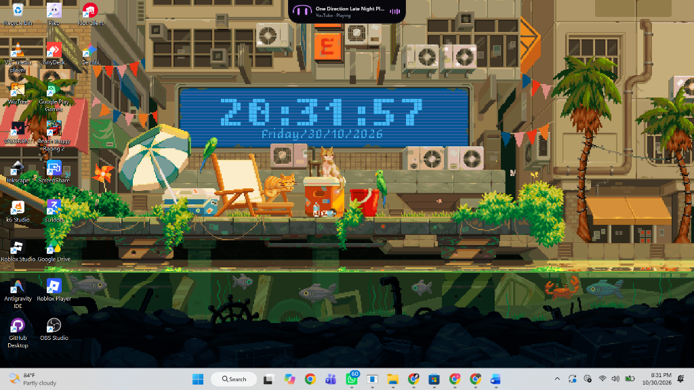
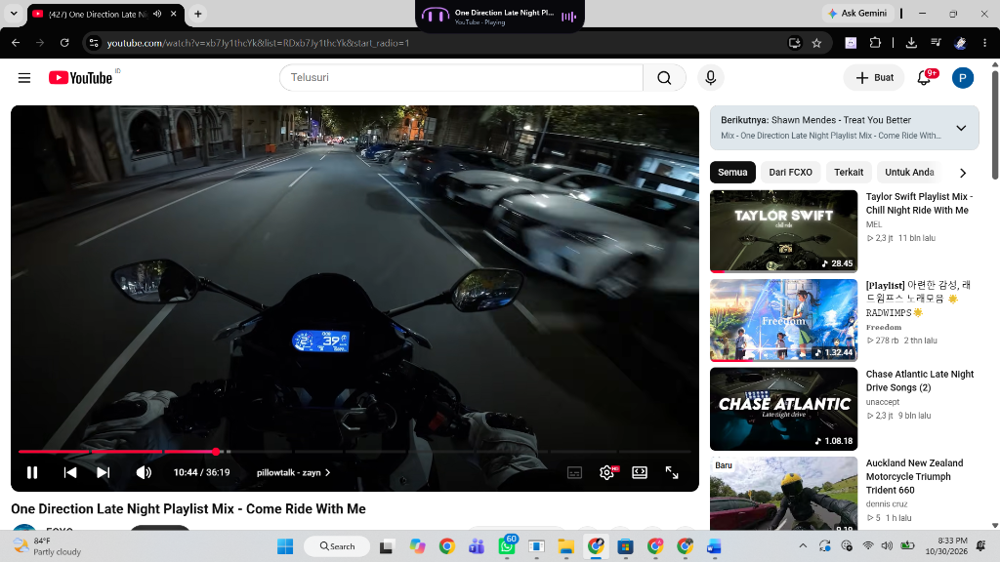
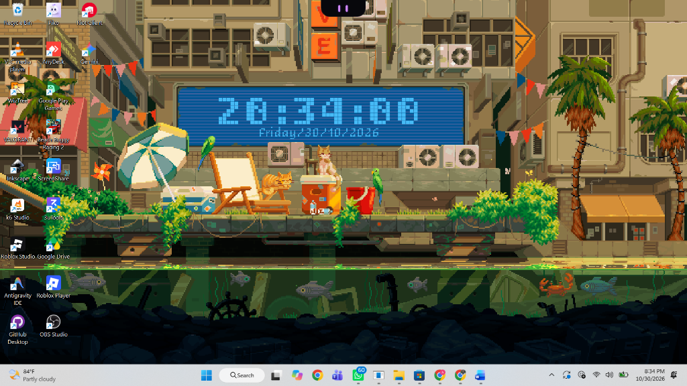
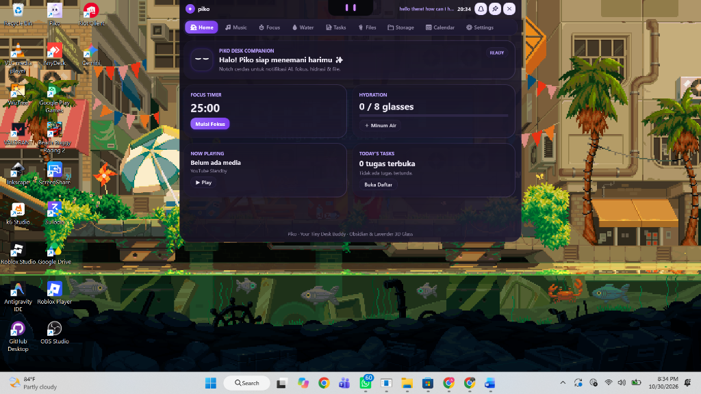
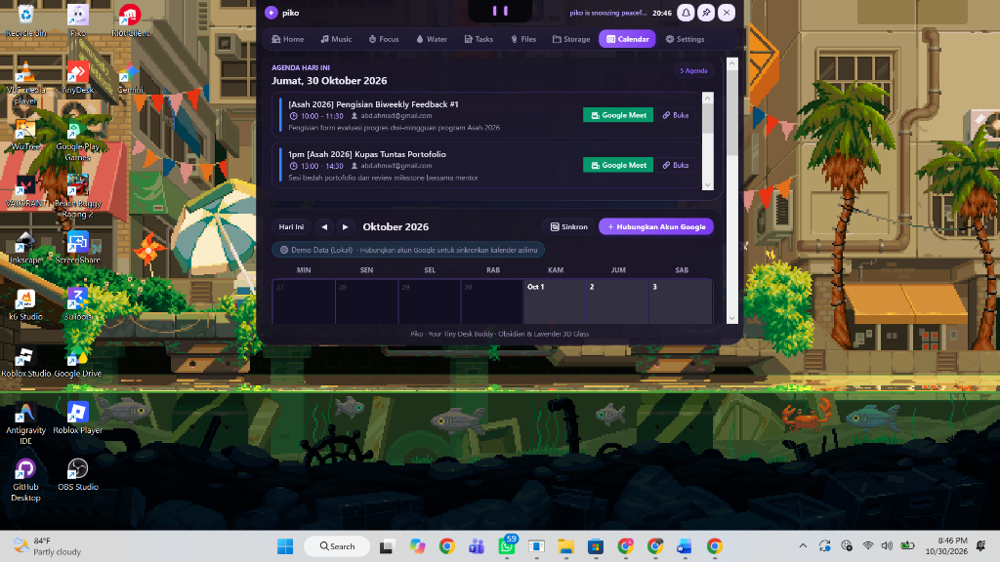
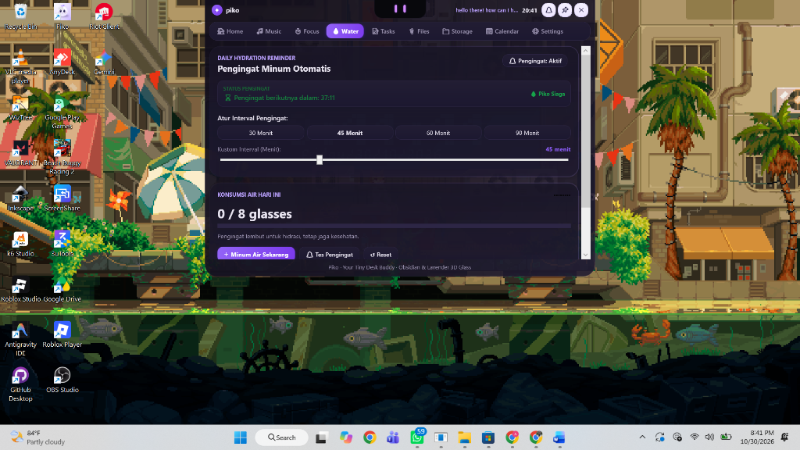
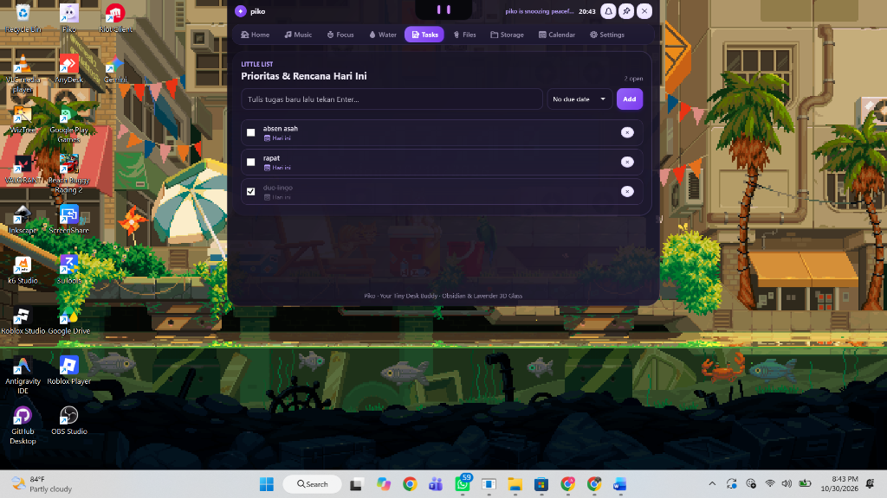
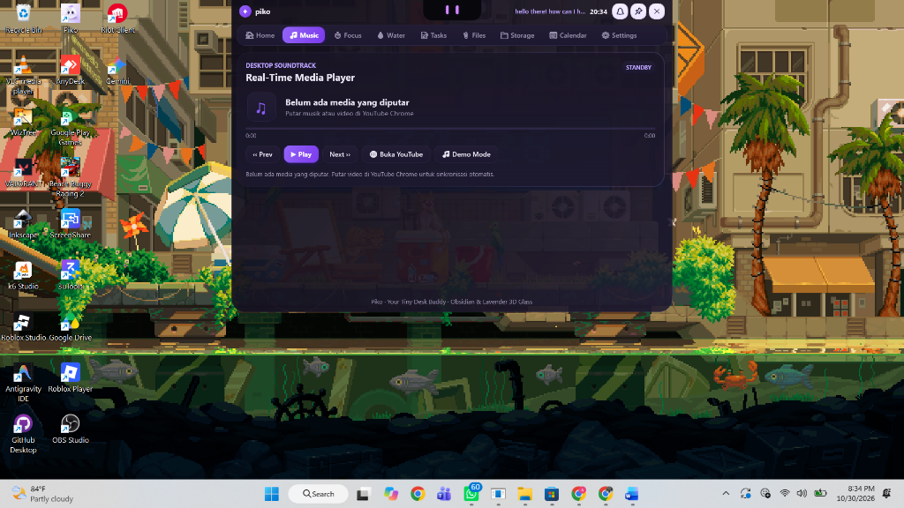
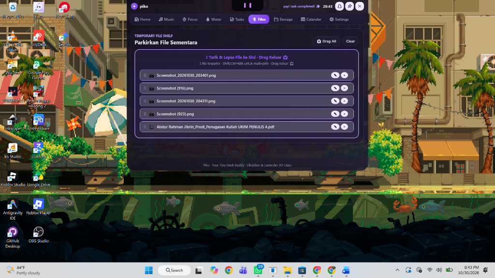
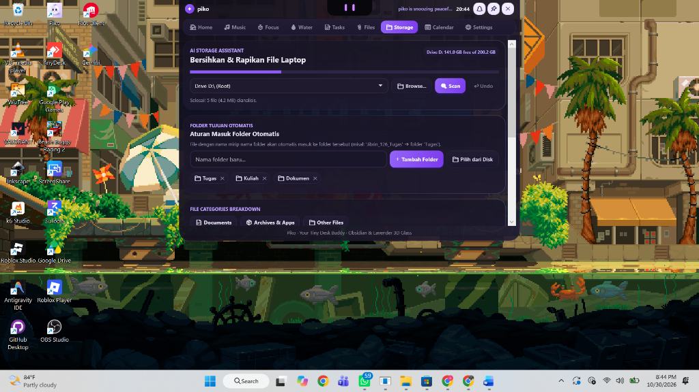

<div align="center">

# 🦊 Piko — Dynamic Island AI Desktop Companion

**Teman Digital Desktop Interaktif & Pendamping Produktivitas untuk Windows 10 & 11**

[-0078D6?logo=windows&logoColor=white)](https://github.com/abdurrahmanjibrin/Piko-Desktop-Companion)
[](https://dotnet.microsoft.com/)
[-4285F4?logo=google-chrome&logoColor=white)](https://github.com/abdurrahmanjibrin/Piko-Desktop-Companion)
[](LICENSE)
[](#-unit-tests)

[🇬🇧 **English Documentation (README.md)**](README.md) · [✨ Fitur](#-fitur-utama) · [📥 Panduan Instalasi](#-cara-instalasi--menjalankan) · [📅 Setup Google Calendar](#-cara-menghubungkan-google-calendar) · [⚡ AI Bridge](#-ai-bridge-antigravity--chatgpt--gemini)

</div>

---

## 📖 Tentang Piko

**Piko** adalah karakter desktop interaktif yang terinspirasi dari konsep **Dynamic Island**. Piko tinggal di bagian atas layar desktop Anda sebagai kapsul mini (*floating notch*) yang elegan, tidak memakan tempat, dan selalu berada di depan jendela aplikasi lain (*always-on-top*).

Piko dirancang untuk membuat suasana bekerja di depan laptop lebih hidup, menyenangkan, dan produktif. Piko menemani Anda saat menunggu AI berpikir, mengingatkan minum air, mengatur ritme kerja dengan teknik Pomodoro, menata file laptop yang berantakan, dan menampilkan jadwal Google Calendar harian dengan desain modern **Obsidian & Lavender Glassmorphism**.

---

## ✨ Fitur Utama

### 1. Dynamic Island & Animasi Mata Hidup
- **Floating Pill Capsule:** Menetap di atas layar dengan sudut rounded modern, animasi ekspansi (*expand*) dan penyusutan (*collapse*) yang sangat mulus tanpa kedip (*flicker-free*).
- **🎯 100% Tidak Mengganggu & Bebas Digeser (Klik 2 Kali & Drag):**
  - Piko dirancang agar tidak menghalangi tab browser, bilah judul jendela aplikasi, atau webcam laptop Anda.
  - **Klik 1 Kali:** Membuka/menutup dashboard atau mencatat minum air saat pengingat aktif.
  - **Klik 2 Kali & Tahan (Drag):** Klik 2x pada kapsul Piko lalu geser mouse untuk memindahkan posisi Piko ke mana pun di layar monitor (tengah atas, pojok kanan, pojok kiri, atau mengambang bebas). Piko otomatis mengingat posisi kustom Anda saat aplikasi dibuka kembali!
- **Mata Vektor Ekspresif:** Mata Piko bukan gambar gif statis, melainkan sistem vektor prosedural yang dapat melirik mengikuti kursor Anda, berkedip alami, dan bereaksi sesuai aktivitas:
  - `Idle`: Bernapas lembut dan berkedip acak setiap beberapa detik.
  - `Hover`: Melirik dan fokus menatap kursor mouse Anda.
  - `Working`: Pupil beranimasi bergerak memantau tugas yang sedang berjalan.
  - `Thinking`: Mata menyipit fokus saat AI sedang menyusun jawaban.
  - `Success`: Menampilkan lengkungan gembira (`^ ^`) disertai lonceng sukses merdu.
  - `Alert`: Mata membesar waspada saat ada pengingat penting.
  - `Sleepy`: Kelopak mata sayu mengantuk saat Anda tidak berinteraksi lama.

---

## 🖼️ Galeri Tangkapan Layar (Visual Showcase)

<div align="center">

### 1. Dynamic Island & Kapsul Desktop
| 🎧 Dynamic Island dengan Visual Headphone & Equalizer | 🌐 Tampilan Mengambang Bebas di Atas Video YouTube |
| :---: | :---: |
|  |  |

| 🦊 Kapsul Mini Notch Minimalis di Bagian Tengah Atas Layar |
| :---: |
|  |

<br>

### 2. Dashboard Produktivitas (Obsidian & Lavender 3D Glass)
| 🏠 Dashboard Home & Ringkasan Harian | 📅 Jadwal Google Calendar & Tombol 1-Klik Meet |
| :---: | :---: |
|  |  |

| 💧 Pengatur Pengingat Minum Otomatis (Water Break) | 📝 Little List (Manajemen Tugas & Prioritas) |
| :---: | :---: |
|  |  |

<br>

### 3. Kontrol Media & Asisten Penyimpanan Pintar
| 🎵 Pemutar Musik Real-Time & Sinkronisasi YouTube | 📎 Temporary File Shelf (Parkir File Sementara) |
| :---: | :---: |
|  |  |

| 📁 AI Storage Assistant (Penata Folder Otomatis & Tombol Undo) |
| :---: |
|  |

</div>

---

### 2. Multi-AI Bridge (Pemantauan Banyak AI Sekaligus)
- Mendeteksi secara langsung saat AI sedang berpikir atau mengetik:
  - **Google Antigravity IDE:** Otomatis terdeteksi oleh background watcher service tanpa perlu konfigurasi tambahan.
  - **ChatGPT, Gemini, Claude, DeepSeek:** Terdeteksi melalui ekstensi browser Chrome/Edge.
- **Monitoring Bersamaan (Multi-AI):** Jika Anda memakai ChatGPT dan Antigravity secara bersamaan, Piko akan menggabungkan statusnya (contoh: `[ChatGPT + Antigravity] sedang berpikir...`) dan memberi tahu saat masing-masing selesai!
- **100% Aman & Privasi Terjaga:** Bridge berkomunikasi murni di jaringan lokal internal komputer Anda (`127.0.0.1:17321`). Piko tidak pernah membaca isi prompt, percakapan, atau data pribadi Anda.

### 3. Google Calendar Multi-Account Sync
- Hubungkan banyak akun Google sekaligus menggunakan **OAuth 2.0** atau **Private iCal URL**.
- Tampilan timeline agenda harian yang rapi dengan penanda garis waktu, warna akun, dan tombol 1-klik langsung join **Google Meet**.
- **Privasi Terjamin:** Kredensial akun dan link kalender Anda tersimpan khusus di komputer lokal Anda (`%LOCALAPPDATA%\Piko\state.json`), **tidak pernah di-upload ke GitHub atau server mana pun**.

### 4. Pomodoro Auto-Interval (Teknik 4 Siklus)
- Menerapkan metode resmi Pomodoro secara otomatis:
  - **Sesi Fokus (25 Menit)** ➔ **Istirahat Pendek (5 Menit)**
  - Ulangi 4 siklus kerja ➔ **Istirahat Panjang (15–30 Menit)**
- Kontrol pemutar lengkap: Mulai (▶), Jeda (⏸), Lewati (⏭), dan Reset (↺).
- Tanpa logo tomat generik—menggunakan visual lavender glassmorphism yang bersih dan elegan.

### 5. Pengingat Hidrasi Cerdas (Daily Hydration)
- Atur interval pengingat minum sesuai kebiasaan Anda (contoh: setiap 30, 45, atau 60 menit).
- Saat waktunya minum tiba, Piko akan berubah menampilkan animasi air minum dengan denting lonceng lembut.
- Pengingat akan berhenti seketika saat Anda mengetuk/mengklik kapsul Piko sebagai konfirmasi bahwa Anda sudah minum air.

### 6. Asisten Penata File Laptop (Smart Storage Organizer)
- Memindai folder pengguna (Downloads, Desktop, Documents, Pictures, Videos).
- Mengelompokkan file ke dalam 6 kategori: *Documents, Images, Media, Code, Archives, Others*.
- Aturan Folder Tujuan Khusus: Nama file yang mengandung nama folder tertentu (misal: `"Dokumen_Tugas"` ➔ folder `Tugas`) akan langsung diarahkan ke folder yang tepat.
- **Prinsip Keamanan Mutlak:** Piko **tidak pernah menghapus file**, otomatis mencegah bentrok nama file duplikat, dan menyediakan tombol **↩ Batalkan (Undo)** 1-klik untuk mengembalikan file ke tempat aslinya.

---

## 💻 Persyaratan Sistem

- **Sistem Operasi**: Windows 10 (versi 64-bit) atau Windows 11.
- **Komponen**: [.NET 8.0 Desktop Runtime](https://dotnet.microsoft.com/en-us/download/dotnet/8.0) (jika menjalankan versi portable non-standalone).
- **Browser (Opsional)**: Google Chrome, Microsoft Edge, Brave, atau browser berbasis Chromium lainnya (untuk ekstensi AI Bridge).

---

## 📥 Cara Instalasi & Menjalankan

### Cara 1: Menggunakan Installer Resmi (Paling Mudah — Sangat Direkomendasikan) 🚀

1. Unduh file **`Piko-Setup-v*.exe`** terbaru dari halaman [Releases GitHub](https://github.com/abdurrahmanjibrin/Piko-Desktop-Companion/releases).
2. Klik ganda file `Piko-Setup-v*.exe` dan ikuti wizard instalasi.
3. ✅ **Shortcut Desktop & Start Menu** akan otomatis dibuat dengan ikon Piko.
4. ✅ Terdaftar resmi di Windows Settings (bisa di-uninstall kapan saja secara bersih).
5. Centang **"Launch Piko Desktop Companion"** lalu klik **Finish** ➔ Kapsul Dynamic Island akan langsung muncul di bagian tengah atas layar Anda!

> **Opsi Alternatif (Portable ZIP):** Bagi yang tidak ingin menginstal ke sistem, Anda juga dapat mengunduh `Piko-Desktop-Companion-v*.zip`, ekstrak ke folder mana pun, buat shortcut manual ke Desktop, lalu jalankan `Piko.exe`.

---

### Cara 2: Build Mandiri dari Source Code (Untuk Pengembang / Developer)

#### 1. Clone Repositori
Buka PowerShell atau Terminal di komputer Anda:
```powershell
git clone https://github.com/abdurrahmanjibrin/Piko-Desktop-Companion.git
cd Piko-Desktop-Companion/PikoStarter
```

#### 2. Build dan Jalankan Aplikasi
Pastikan [.NET 8 SDK](https://dotnet.microsoft.com/download/dotnet/8.0) sudah terpasang di komputer Anda:
```powershell
# Build solusi dalam mode Release
dotnet build Piko/Piko.csproj -c Release

# Jalankan Piko
dotnet run --project Piko/Piko.csproj
```

#### 3. Membuat Paket Executable Standalone
Jika Anda ingin membuat folder executable portable tanpa ketergantungan SDK:
```powershell
dotnet publish Piko/Piko.csproj -c Release -r win-x64 --self-contained false -o ./publish
```

#### 4. Mengompilasi Installer Resmi Windows (`Piko-Setup.exe`)
Untuk membuat file installer `.exe` lengkap yang siap didistribusikan ke pengguna lain:
1. Pastikan [Inno Setup 6](https://jrsoftware.org/isdl.php) terpasang di komputer Anda (`winget install JRSoftware.InnoSetup`).
2. Jalankan script builder:
   ```cmd
   build_installer.bat
   ```
3. File installer `Piko-Setup-v0.2.0.exe` akan langsung dibuat secara otomatis di dalam folder `dist/`.

---

## 🧩 Memasang Ekstensi Browser (Chrome / Edge)

Ekstensi browser digunakan untuk menghubungkan status generasi ChatGPT, Gemini, dan kontrol musik YouTube ke Piko:

1. Jalankan aplikasi Piko di desktop Anda terlebih dahulu (bridge lokal akan aktif di `127.0.0.1:17321`).
2. Buka browser Chromium Anda dan buka halaman ekstensi:
   - Di Google Chrome: ketik `chrome://extensions` di address bar.
   - Di Microsoft Edge: ketik `edge://extensions` di address bar.
3. Aktifkan tombol **Developer mode** (Mode Pengembang) di pojok kanan atau kiri atas.
4. Klik tombol **Load unpacked** (*Muat yang belum dibongkar*).
5. Pilih folder: `PikoStarter/PikoBrowserExtension`.
6. Klik ikon puzzle di toolbar browser dan sematkan (*pin*) ikon Piko. Saat terhubung, badge ekstensi akan berwarna hijau bertuliskan `ON`!

---

## 📅 Cara Menghubungkan Google Calendar

Piko menyediakan 2 opsi mudah untuk menghubungkan kalender Anda. **Semua data dan kredensial Anda disimpan 100% aman di komputer lokal Anda sendiri (`%LOCALAPPDATA%\Piko\state.json`) dan tidak pernah dikirim ke pihak ketiga.**

### Metode 1: Menggunakan Link Rahasia iCal (Paling Praktis — Tanpa Perlu Setup API!)

1. Buka [Google Calendar](https://calendar.google.com/) di browser Anda.
2. Pada panel samping kiri, arahkan kursor ke kalender Anda ➔ klik **titik tiga (⋮)** ➔ pilih **Settings and sharing** (*Setelan dan berbagi*).
3. Gulir ke bawah hingga Anda menemukan bagian **Integrate calendar** (*Integrasikan kalender*).
4. Salin link pada kolom **Secret address in iCal format** (*Alamat rahasia dalam format iCal*):
   *(Bentuk link berupa: `https://calendar.google.com/calendar/ical/.../basic.ics`)*.
5. Pada Piko di desktop Anda, klik kapsul untuk membuka dashboard ➔ klik tab **Calendar**.
6. Klik tombol **＋ Tambah Akun Google** ➔ pilih **Metode iCal URL**.
7. Masukkan nama tampilan/email akun Anda, tempel (*paste*) link iCal tadi, dan pilih warna akun.
8. Klik **Simpan & Sinkronkan**. Jadwal dan link Google Meet Anda akan langsung tampil!

---

### Metode 2: Menggunakan Akun Google Cloud OAuth 2.0 (Resmi)

1. Buka [Google Cloud Console](https://console.cloud.google.com/).
2. Buat Project baru (contoh nama: `Piko Desktop Companion`).
3. Buka menu **APIs & Services** ➔ **Library** ➔ cari dan aktifkan **Google Calendar API**.
4. Masuk ke **OAuth consent screen**:
   - Pilih tipe **External** ➔ isi nama aplikasi.
   - Pada bagian **Test Users**, tambahkan alamat email Google Anda.
5. Masuk ke menu **Credentials** ➔ klik **Create Credentials** ➔ pilih **OAuth Client ID**.
   - Pilih Application type: **Desktop app**.
6. Salin **Client ID** dan **Client Secret** yang dihasilkan.
7. Di Piko, buka tab **Calendar** ➔ klik **＋ Tambah Akun Google** ➔ pilih **Metode OAuth 2.0**.
8. Masukkan Client ID dan Client Secret, lalu klik **Hubungkan dengan Google**. Jendela browser akan terbuka secara aman untuk meminta izin akses kalender.

---

## ⚡ AI Bridge (Antigravity, ChatGPT, Gemini, dll.)

### Google Antigravity IDE
Piko memantau sesi pengerjaan kode Antigravity IDE secara otomatis melalui file sesi lokal. Anda tidak perlu memasang plugin tambahan—cukup biarkan Piko berjalan saat Anda menggunakan Antigravity IDE!

### ChatGPT, Gemini, Claude, DeepSeek
Setelah [memasang ekstensi browser](#-memasang-ekstensi-browser-chrome--edge), setiap kali Anda mengirim pertanyaan ke AI:
- Mata Piko berubah menjadi animasi bekerja/berpikir.
- Kapsul Dynamic Island melebar dan menampilkan nama AI yang sedang aktif.
- Saat jawaban selesai dibuat, Piko membunyikan denting suara merdu dan memberi notifikasi bahwa jawaban Anda sudah siap!

---

## 🧪 Menjalankan Pengujian (Unit Tests)

Piko dilengkapi dengan 17 unit test xUnit yang memverifikasi stabilitas sistem:

```powershell
dotnet test PikoStarter/Piko.Tests/Piko.Tests.csproj
```
Hasil pengujian:
```text
Passed!  - Failed: 0, Passed: 17, Skipped: 0, Total: 17
```

---

## 📂 Struktur Folder Repositori

```text
PikoStarter/
├── Piko/                               # Kode Sumber Utama Desktop WPF (.NET 8)
│   ├── App.xaml / App.xaml.cs          # Manajemen Single Instance (Mutex) & Lifecycle
│   ├── MainWindow.xaml / .cs           # Desain Dynamic Island & Dashboard 9 Tab
│   ├── Models/                         # Model data: AppState, PikoEmotions, Kalender
│   ├── Services/
│   │   ├── AntigravityWatcherService.cs# Monitor pembuatan respons Antigravity IDE
│   │   ├── GoogleCalendarService.cs    # Layanan sinkronisasi Google Calendar
│   │   ├── LocalBridgeService.cs       # Bridge komunikasi lokal (127.0.0.1:17321)
│   │   ├── PikoEyeController.cs        # Pengontrol kinematika mata vektor Piko
│   │   ├── StatePersistenceService.cs  # Penyimpanan data di %LOCALAPPDATA%\Piko
│   │   └── StorageOrganizerService.cs  # Layanan penataan file & pencegahan konflik
│   ├── PikoLauncher.vbs                # Script peluncur portable tanpa jendela konsol
│   └── Piko.csproj                     # Konfigurasi project C# WPF
├── PikoBrowserExtension/               # Ekstensi Browser Chrome/Edge (Manifest V3)
│   ├── manifest.json                   # Definisi ekstensi browser
│   ├── content.js                      # Monitor DOM untuk ChatGPT, Gemini, Claude
│   ├── media_content.js                # Bridge media audio & YouTube
│   └── service_worker.js               # Pengirim pesan loopback ke aplikasi desktop
├── Piko.Tests/                         # Unit Test xUnit (17 Pengujian)
│   ├── UnitTest1.cs                    # Test logic bridge, organizer, dan state
│   └── Piko.Tests.csproj
├── README.md                           # Dokumentasi Bahasa Inggris
└── README.id.md                        # Panduan Lengkap Bahasa Indonesia
```

---

## 🔒 Privasi dan Keamanan

- **Penyimpanan Lokal Saja:** Seluruh konfigurasi, catatan to-do, dan data akun kalender tersimpan aman di direktori lokal komputer Anda:
  ```text
  %LOCALAPPDATA%\Piko\state.json
  ```
- **Tanpa Telemetri Tersembunyi:** Piko tidak melacak aktivitas Anda dan tidak mengirim data apa pun ke server eksternal.
- **Port Loopback Terproteksi:** Bridge hanya menerima koneksi internal dari `127.0.0.1:17321` dengan token otorisasi bawaan.

---

## 📄 Lisensi

Proyek ini berada di bawah lisensi [MIT License](LICENSE). Silakan gunakan, pelajari, dan kembangkan sesuka hati! Kontribusi dan saran fitur baru sangat disambut dengan hangat.
